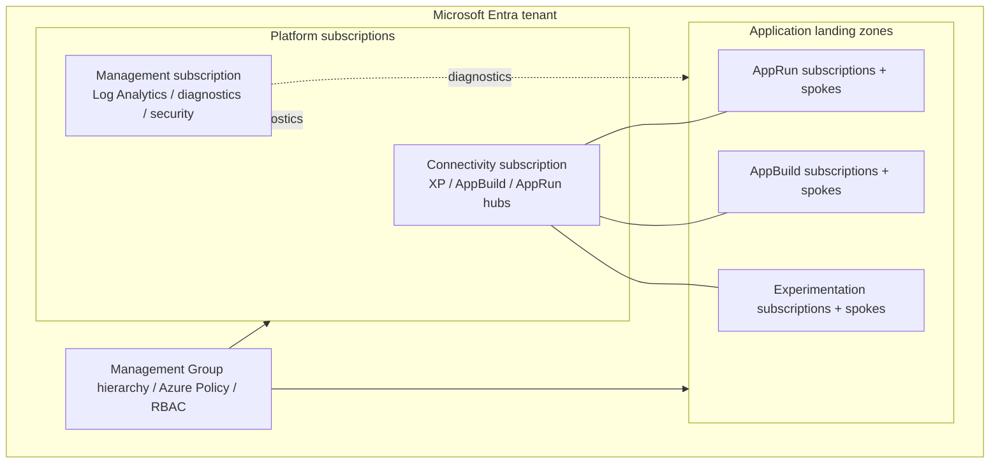

# Azure Enterprise Landing Zone

> **Architecture-first Terraform project** · Design phase · No infrastructure deployed

An independently designed, modular Azure Landing Zone platform for governance, centralized operations, segmented networking, and repeatable application subscription onboarding.

The repository starts with a documented target architecture. Terraform implementation will be added in a separate phase after design and permission checks.

## Architecture at a glance



The diagram represents **target logical separation**, not existing subscriptions or deployed resources. The three connectivity domains may be hosted in a single connectivity subscription. Network peering is planned **within** each domain, not automatically between every spoke.

## Design principles

- **Platform vs. workloads:** independent Terraform roots for shared foundation and application onboarding.
- **Governance first:** Management Groups, policy assignments, RBAC, and subscription placement precede resource deployment.
- **Domain isolation:** XP (experimentation), AppBuild (build systems), and AppRun (runtime workloads) have separate network plans.
- **Composable modules:** `core`, `management`, and one connectivity module per domain.
- **Controlled onboarding:** register existing subscriptions, place them in the correct Management Group, and configure application spokes.
- **Safe execution:** no resources are created by cloning this repository; expensive network services are optional and require explicit approval.

## Repository structure

```text
azure-enterprise-landing-zone/
├── README.md
├── docs/
│   ├── architecture.md
│   ├── network-design.md
│   ├── implementation-plan.md
│   └── adr/
│       ├── 0001-separate-terraform-roots.md
│       ├── 0002-connectivity-domains.md
│       └── 0003-subscription-onboarding.md
├── diagrams/
│   ├── management-groups.md
│   └── delivery-flow.md
├── main-infra/                 # Platform root (implementation later)
├── main-bp/                    # Application landing-zone root (implementation later)
└── modules/
    ├── core/
    ├── management/
    ├── connectivity-xp/
    ├── connectivity-appbuild/
    └── connectivity-apprun/
```

Empty implementation directories contain `.gitkeep` files to reserve the module boundaries.

## Design status

| Area | Target design | Implementation |
|---|---|---|
| Management Groups, Azure Policy and RBAC | Specified | Not started |
| Central monitoring and security | Specified | Not started |
| XP / AppBuild / AppRun hub networks | Specified | Not started |
| Subscription onboarding and spoke networking | Specified | Not started |
| Terraform state and deployment process | Boundary specified | Pending selection |

## Documentation

- [Architecture and module interfaces](docs/architecture.md)
- [Network and connectivity design](docs/network-design.md)
- [Implementation and validation sequence](docs/implementation-plan.md)
- [Management Group hierarchy](diagrams/management-groups.md)
- [Platform-to-application delivery flow](diagrams/delivery-flow.md)
- [Architecture decision records](docs/adr/0001-separate-terraform-roots.md)

## Preconditions before deployment

Multi-subscription deployment requires suitable Azure subscriptions and authorization to manage Management Groups, policy assignments, and subscription placement. The project can be reviewed and versioned with only one Azure subscription, but the full target topology cannot be deployed until those prerequisites are met.

All credentials and environment variables are provided externally by the operator; **secret-management tooling is outside this repository's scope**.

## Official resources

- [Microsoft Azure Landing Zones](https://learn.microsoft.com/en-us/azure/cloud-adoption-framework/ready/landing-zone/)
- [Azure Landing Zone design areas](https://learn.microsoft.com/en-us/azure/cloud-adoption-framework/ready/landing-zone/design-areas)
- [Terraform modules](https://developer.hashicorp.com/terraform/language/modules)
- [Terraform state](https://developer.hashicorp.com/terraform/language/state)
- [Azure Landing Zone Vending module](https://github.com/Azure/terraform-azurerm-lz-vending)
