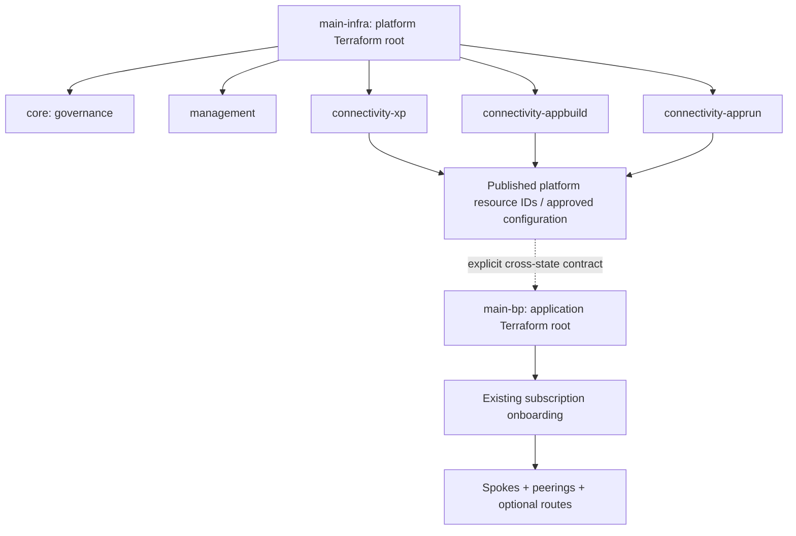

# Deployment boundary and integration

The dashed edge is a data contract between Terraform states, not a direct dependency between local modules. The external delivery mechanism and secret injection are deliberately outside architecture scope.
