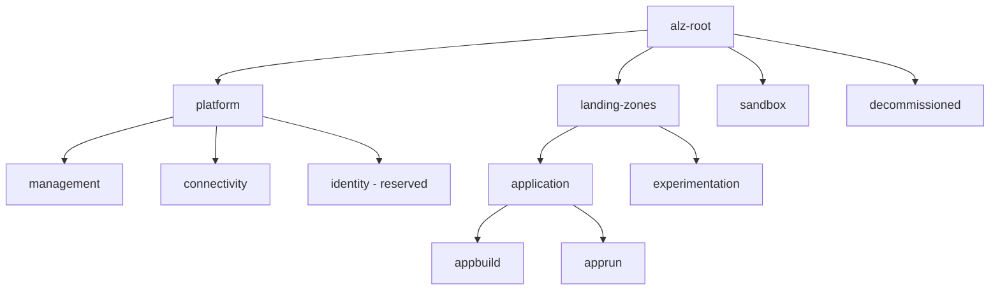

# Target Management Group hierarchy

The identity branch is reserved for a future platform capability and is not implemented by the initial module set. Subscription association and policy inheritance follow actual Azure Management Group scope rules.
