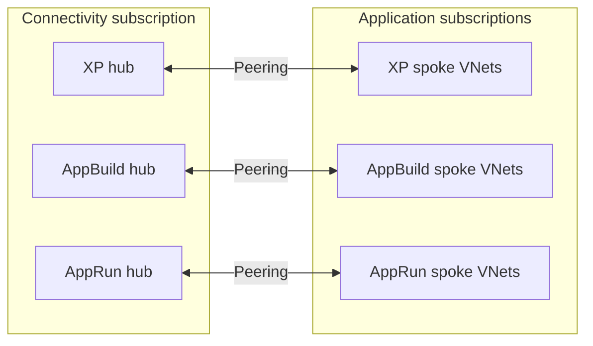

# Network design

## Domains

Three network domains are independently addressed and configured: **XP**, **AppBuild**, **AppRun**. Each has a dedicated hub VNet with reserved subnets for connectivity services, plus application spoke VNets hosted in workload subscriptions. Hubs may share one Connectivity subscription.

## Hub components

| Component | Design |
|---|---|
| Virtual network | Distinct, non-overlapping CIDR per domain |
| GatewaySubnet | Reserved only if network gateways are planned |
| AzureBastionSubnet | Reserve a subnet of a supported size if Bastion is enabled |
| AzureFirewallSubnet | Reserve a dedicated subnet if Firewall is enabled |
| AzureFirewallManagementSubnet | Only when the chosen Firewall deployment mode requires it |
| SharedServicesSubnet | For approved shared services in that hub |

Subnet sizing and specific CIDR allocations will be validated against current Azure service requirements before implementation. **No production-like addresses have been copied**; the actual IP plan is intentionally pending to avoid creating false deployment-ready assumptions.

## Spoke onboarding

The application root will accept an enabled subscription inventory, select the target domain, create spoke VNets and approved subnets, configure bidirectional peering when necessary, and optionally add route tables for a deployed Firewall. IP range conflicts and peering constraints must be validated before `apply`.

## Security and cost

Azure Firewall, Azure Bastion and DDoS Network Protection are optional features—not default deployments. The architecture supports them, but their recurring cost and SKU prerequisites must be reviewed separately. Peering does not automatically imply transitive routing or full connectivity between all spokes.

## Acceptance criteria

- Non-overlapping address spaces for all VNets and peering pairs.
- No unapproved public management endpoints.
- Clear separation of routing and access rules per domain.
- Documented relationship between hub services, DNS and route tables.
- Costed, testable plan before deploying any paid network service.
